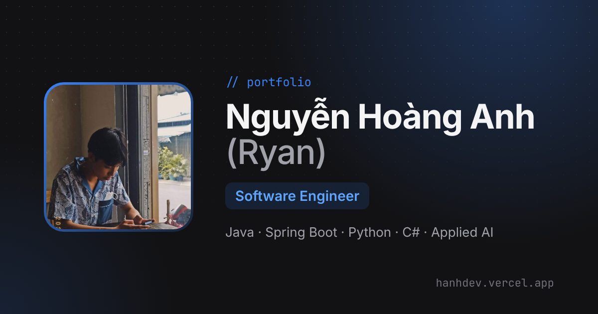

# Nguyễn Hoàng Anh (Ryan) — Portfolio

Personal portfolio of **Nguyễn Hoàng Anh (Ryan)**, Software Engineer.

🔗 **Live:** https://hanhdev.vercel.app



## Features

- **Sidebar + scrolling layout:** sticky profile card on the left; About, Resume, Projects and Contact sections scroll on the right
- **Sticky topbar** with scroll-spy highlighting; every section has a shareable link (`/#projects`)
- **Light / dark theme:** the toggle reveals the new theme as a growing circle; follows the OS setting on first visit and remembers the choice
- **Projects:** filter by language, open a case-study modal (Problem → Solution → Highlights)
- **Motion:** staggered reveals, cursor-following spotlight on cards, scroll progress bar. Everything respects `prefers-reduced-motion`
- **Responsive:** on mobile the profile card collapses and the layout stacks
- **SEO / sharing:** Open Graph + Twitter card image, canonical URL, `robots.txt`, `sitemap.xml`

## Tech stack

React 19 · TypeScript · Vite · Tailwind CSS 4 · Framer Motion · react-icons · Google Analytics · Vercel

## Getting started

```bash
npm install
npm run dev       # http://localhost:5173
npm run lint
npm run build     # type-check + production build into dist/
npm run preview   # serve the production build locally
```

Pushing to `main` deploys to Vercel automatically.

## Editing content

Almost all content lives in [`src/constants/data.ts`](src/constants/data.ts):

| What | Where in `data.ts` |
|---|---|
| Name, role, email, location, social links, CV | `personalInfo` |
| About text | `personalInfo.description`, `about.bio` |
| "What I'm doing" cards | `services` |
| Work experience timeline (hidden while empty) | `experience` |
| Education | `education` |
| Projects (+ filter via `stack`) | `projects` |
| Tech stack (grouped, `primary` = highlighted) | `techStack`, `techGroups` |
| Interests | `interests` |

Images and the CV PDF are in `src/assets/`. Replace a file with one of the same name, or update its import at the top of `data.ts`.

### Adding an experience entry

```ts
export const experience: ExperienceItem[] = [
  {
    company: 'Company name',
    role: 'Software Engineer Intern',
    period: 'Sep 2026 – Present',
    location: 'Ho Chi Minh City',
    highlights: ['What you built or improved', 'Another achievement'],
    tech: ['Java', 'Spring Boot'],
  },
];
```

### Icons

Brand and technology icons are self-hosted SVGs in `public/icons/`, from [coloured-icons](https://github.com/dheereshag/coloured-icons) (MIT). They are used as `<i className="ci ci-java ci-xl" />`. To add one, copy its logo into `public/icons/` and add a rule to [`src/styles/icons.css`](src/styles/icons.css).

## Project structure

See [PROJECT_STRUCTURE.md](PROJECT_STRUCTURE.md).
